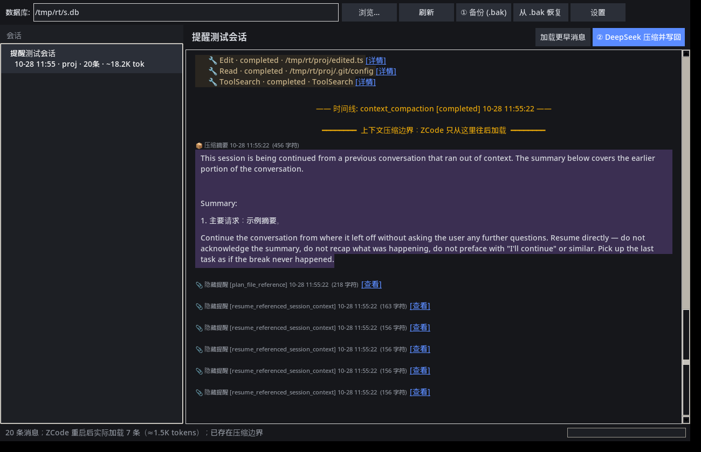

# ZCode 会话救援工具（zcode_rescue）

单文件 Python 桌面工具（标准库 + tkinter）。它备份 ZCode 的会话数据库，用侧边栏浏览会话，再调用 DeepSeek 把过长的会话压成摘要，并按 ZCode 原生的「手动压缩」结构写回数据库。重启 ZCode 之后，这个会话会以压缩后的状态加载。



> **请先读完这段再使用。**
>
> - 本工具是**非官方**作品，与 Z.ai、ZCode **没有**隶属、授权或背书关系。
> - 使用前请**完全退出 ZCode**（包括系统托盘里的进程）。
> - **务必先做 `.bak` 备份，并一直留着这份备份。** 写回只追加压缩记录，不删除旧消息；一旦写回不被新版本识别，用备份恢复。
> - 会话库是本地数据，摘要会发给你配置的 DeepSeek（或兼容）接口。API Key 只保存在本机。
> - **风险自负。** 作者不对数据丢失、摘要错误或 ZCode 无法加载会话承担责任。

本工具对照 [ZCode](https://github.com/zai-org/ZCode) 开源仓库的数据结构编写（Apache-2.0）。压缩提示词移植自 `core/src/compact/prompt.ts`，写回格式对齐 `compact-active.ts` / `compact-persistence.ts` 的手动压缩，参考提交为 `3c5b227`（2026-10）。ZCode 及其数据结构的版权归原作者所有，本仓库只包含救援工具本身。

## 环境要求

- **Windows**（界面字体和 `启动.bat` 按 Windows 准备；官方 Python 安装包自带 tkinter）
- **Python 3.10 或更高**
- **DeepSeek API Key**，填在「设置」里，或事先设置环境变量 `DEEPSEEK_API_KEY`

默认数据库路径是 `%USERPROFILE%\.zcode\cli\db\db.sqlite`，也认环境变量 `ZCODE_SESSION_DB_PATH`。

## 快速开始

1. 完全退出 ZCode。工具若检测到 ZCode 仍在运行，会先提醒你。
2. 双击 [`启动.bat`](启动.bat)。它会依次尝试 `pythonw`、`pyw -3`、`python`、`py -3`。都找不到时，会提示到 [python.org/downloads](https://www.python.org/downloads/) 安装，安装时勾选 “Add python.exe to PATH”。也可以在仓库目录执行 `python zcode_rescue.py`。
3. 确认顶部数据库路径。不对就点「浏览…」。
4. 点「① 备份 (.bak)」。已有 `db.sqlite.bak` 时，会改用带时间戳的文件名 `db.sqlite.YYYYmmdd-HHMMSS.bak`。
5. 在左侧选中卡住的会话，点「② DeepSeek 压缩并写回」：
   - 提示词可以改。默认会附加一句「用中文写摘要，代码和路径保持原样」。
   - 点「开始」后摘要流式显示，可以随时取消，生成完还可以手动改。
   - 「同时写入 ZCode 压缩后提醒」默认勾选，旁边会显示条数和 token 数。点「预览附件」可以先看每一条的完整内容。
   - 点「写回」。整次写入在一个事务里完成。
6. 重新打开 ZCode，进入该会话继续工作。

## 它做什么

1. **备份。** 用 SQLite 在线备份 API 把 `db.sqlite` 复制成 `.bak`。WAL 里还没写进主库的内容也会带上，备份结束后自动跑 `integrity_check`。原库不改名、不搬动。
2. **浏览。** 深色侧边栏列出全部会话（标题、时间、目录、消息数、估算 token）。右侧是气泡式对话：工具调用默认折叠，点开看详情；压缩摘要和压缩边界有标注。消息多时分页加载。
3. **压缩并写回。** 用 ZCode 自己的压缩提示词调用 DeepSeek，生成摘要后按原生手动压缩结构写回。下次打开 ZCode，这个会话就已经是压缩过的状态。

## 原理

ZCode 冷启动时，从**最后一个压缩边界**开始读会话。更早的消息仍留在库里，只是不再发给模型。本工具不删除任何旧行，只在会话末尾追加 ZCode 能识别的压缩记录，因此重启后加载的是压缩结果。

待压缩文本来自当前压缩边界之后、对模型可见的消息。工具输出默认最多保留 4000 字符。对话超过单块上限（默认 60 万 token）时自动分块：前面几块滚动累积成摘要，最后一块用完整提示词出最终结果。token 按「字符数 ÷ 3」估算，与 ZCode `ESTIMATED_TOKEN_CHAR_DIVISOR` 一致。

### 写回的内容

与 ZCode 手动压缩一致：

- 一条隐藏的 assistant「时间线」消息（`timeline` part 与 `context_compaction`，加上 `compaction` part，状态为 `completed`）。
- 一条 user「压缩摘要」消息（`semantics.kind=compact_summary`）：synthetic text part 的正文是 ZCode 的续接模板加摘要；再加一个带 `compactBoundary`（`trigger=manual`）的 `compaction` part。
- 默认再写入「压缩后提醒」。每条是一条隐藏的 user 消息（`semantics.kind=system_reminder`，`visibility=model-only`）。格式、顺序和数量上限照搬 `compact-post-reminders.ts`、`plan-file-continuity.ts` 和 `runtime-reminder-persistence.ts`：
  1. **计划文件**：`<会话目录>\.zcode\plans\plan-<会话ID>.md`，存在且不为空才附上，最多约 81 KB。
  2. **最近读过的文件**：按读取时间从新到旧，最多 5 个；每个最多约 5000 token，合计最多 5 万 token。超过上限的文件只写一句「内容太大，需要时请用 Read 重新读取」。
     - 只算没有指定 offset/limit 的完整 Read。同一个文件之后又被 Write/Edit 过，就不再附上。`.git/` 等路径跳过。这些规则与 ZCode 相同。
     - 文件内容取自**数据库里那次读取时保存的快照**（`readFileState`），不是磁盘上的当前文件。ZCode 重启后恢复读文件状态用的也是这份快照。
- 压缩边界里同样写入 `preCompactDiscoveredTools`（压缩前通过 ToolSearch 发现的工具）。

**有意不写的部分**

- 子代理列表和延迟工具清单：ZCode 每一轮开始时都会对照历史，自动补发这两项的增量。压缩后的第一轮它会自己补上，再写一份会重复。
- 待办（todo）、目标、MCP 和技能说明：ZCode 压缩时本来就不追加这些。待办提醒也是每轮由运行时自己生成。

### DeepSeek 配置

- 在「设置」里填写 API Key，或设置环境变量 `DEEPSEEK_API_KEY`。配置保存在 `~/.zcode_rescue.json`（明文，不要把这个文件外传，也不要提交到仓库）。
- 默认 `base_url=https://api.deepseek.com`、`model=deepseek-flash`。可以改成 `deepseek-v4-pro`，或任何兼容 OpenAI Chat Completions 的服务。参考 [DeepSeek 定价说明](https://api-docs.deepseek.com/quick_start/pricing)。

## 恢复

点「从 .bak 恢复」，选一个备份。恢复前会先把当前库再备份一次，所以这一步也可以撤销。

也可以手动恢复：退出 ZCode，删掉 `db.sqlite-wal` 和 `db.sqlite-shm`，再用 `.bak` 覆盖 `db.sqlite`。

## 风险与限制

- 数据结构以 ZCode 开源提交 `3c5b227`（2026-10）为准。以后版本如果改了表结构或压缩格式，写回可能不被识别。最坏情况是会话加载报错，用 `.bak` 恢复即可。
- 「压缩后提醒」按 ZCode 的规则复刻。差别在于：ZCode 在**运行中**压缩时用的是内存里的读文件状态；本工具只能用数据库里保存的快照。如果某次读取没有保存快照，那个文件就不会被附上。
- 用过「回退 / 分支」（revert、branch cut）的会话结构更复杂，建议先在备份副本上试。
- 摘要质量取决于模型输出。写回前请通读一遍，需要的话直接改文本。
- 不要在 ZCode 运行时写回。

## 打包成 exe（可选）

```bat
pip install pyinstaller
pyinstaller -F -w zcode_rescue.py
```

生成的程序在 `dist\zcode_rescue.exe`。

## 许可

本仓库以 [MIT License](LICENSE) 发布。Copyright (c) 2026 cuixu524541577。

ZCode 本体见 [github.com/zai-org/ZCode](https://github.com/zai-org/ZCode)，许可证为 Apache-2.0，不包含在本仓库中。
